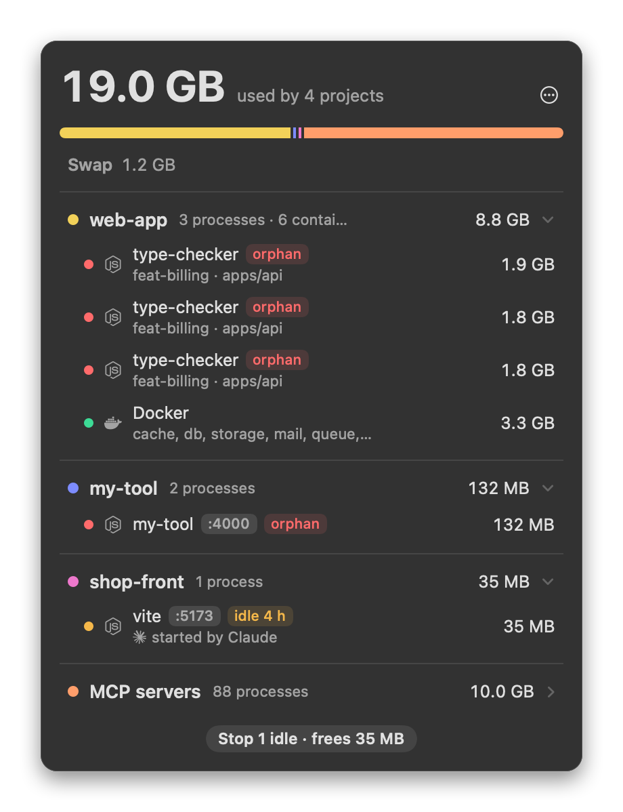
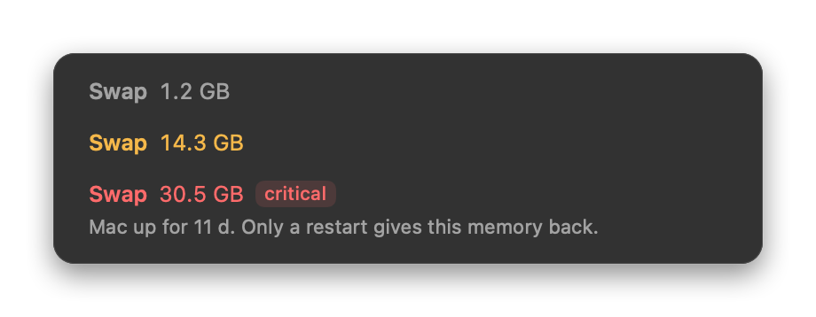
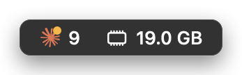
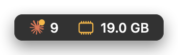
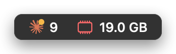
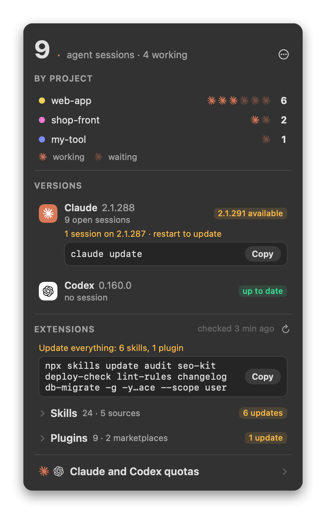
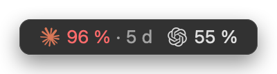
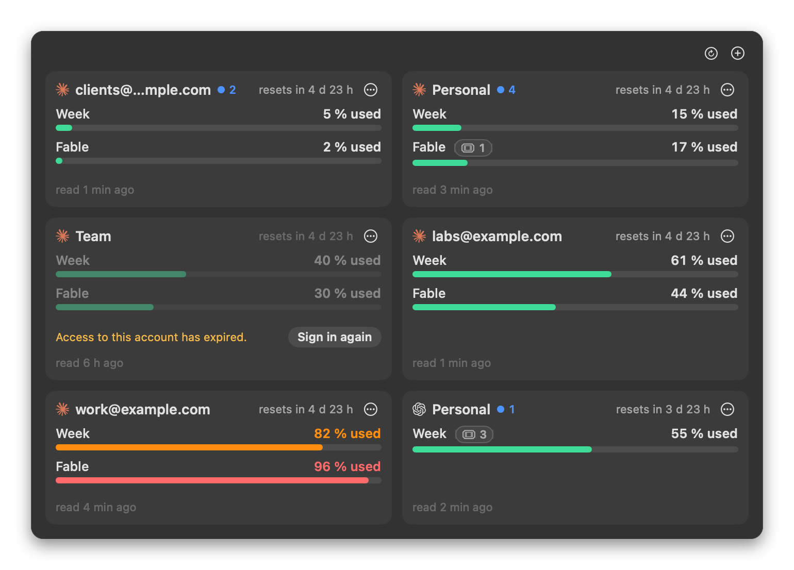

<h1 align="center">DevMonitor</h1>

<p align="center">
  <b>See what your dev setup is really running, from the macOS menu bar.</b><br>
  Dev servers, workers, MCP servers and Docker Compose containers, grouped by git repository,<br>
  with the memory each one holds and two clicks to stop it.
</p>

<p align="center">
  
  
  <a href="LICENSE"></a>
</p>

<p align="center">
  <a href="docs/media/demo.mp4"></a>
</p>

<p align="center"><sub>The 23-second demo. Click it for the video with sound.</sub></p>

DevMonitor is for people who run several projects and coding agents at once. One menu bar item
shows the memory your projects hold and lets you stop what you forgot. A second one counts your
agent sessions and tells you when an agent, a skill or a plugin has a new version. A third one,
once you follow your Claude and Codex accounts, shows how much of each subscription is left.

<p align="center">
  <a href="#install">Install</a> ·
  <a href="#what-it-shows">What it shows</a> ·
  <a href="#guides">Guides</a> ·
  <a href="#safety-and-privacy">Safety and privacy</a> ·
  <a href="#development">Development</a>
</p>

## Install

Paste this in Terminal, without `sudo`:

```bash
curl -fsSL https://raw.githubusercontent.com/samuelbelolo/devmonitor/main/scripts/install.sh | bash
```

It downloads the source, builds the app on your Mac (about a minute), copies it to
`/Applications` (or `~/Applications`) and launches it. Run the same command again to update.

You need macOS 14 or later and Apple's command line developer tools (`xcode-select --install`).
Docker and coding agents are optional. Launch at login, updating, uninstalling and the common
problems are in the [install guide](docs/install.md).

## What it shows

### Everything running, grouped by repository



The memory item (`19.0 GB`) opens a window with one group per repository, worktrees and Compose
containers included. Each line is a service with its memory and its ports. Two tags point at
what you probably forgot:

- `orphan`: its parent died.
- `idle`: no CPU for 10 minutes.

MCP servers have their own collapsed group.

**Stop it in two clicks.** The cross on a line, then **Confirm**, stops that service and
everything it started. **Stop** on a project stops its services and its containers.
**Stop N idle** stops the idle services counted at the first click. A process still running
5 seconds later gets a **Force quit** button.

[The memory window, in detail →](docs/memory-window.md)

<br clear="right">

### Swap, and when only a restart helps



A Mac can crawl while macOS reports plenty of free memory: what it lacks sits in the swap.
Under the total, a **Swap** line is always shown: grey up to a quarter of the Mac's memory,
orange above it, red above half. A red line says how long the Mac has been up and that only a
restart gives this memory back.

The chip in the menu bar takes the same colour:

  

[The Swap line, in detail →](docs/memory-window.md#the-swap-line)

<br clear="right">

### Every agent session, and the update you have not run



The agents item (`✳ 9`) shows the logo of each agent with a session, then their total number of
sessions. Each logo turns while its agent works, and an orange dot means a new version is
published. Its window lists:

- the sessions by project, each one marked as working or waiting;
- each installed agent's version and the command to update it (**Copy**);
- the sessions still running an older version, which need a restart to pick up an update.

It knows Claude Code, Codex, Gemini CLI, Cursor Agent, opencode, Aider and Amp.

[The agents window, in detail →](docs/agents-window.md)

### Skills and plugins with an update

The same window lists the skills installed with `npx skills` and the plugins installed with
`claude plugin`, grouped by repository or marketplace. It says which ones have an update and
gives one command that updates everything, or one command per source (**Copy**).

[Skills and plugins, in detail →](docs/extensions.md)

<br clear="right">

### Every Claude and Codex account, and the room it has

Follow your Claude and Codex accounts from the last line of the agents window, each with a
sign-in of its own in your browser. A third item then shows the share used on the Claude account
your sessions draw on most, and the share used of Codex's fullest limit:



Its window lists, for each account:

- one gauge per limit (the week, the week on Fable, Codex's windows), orange from 80 % and red
  by 95 %, and when they start again;
- a blue dot with the number of agent sessions on your Mac that draw on it;
- a ticket with the number of free resets, beside the limit they start again. A click asks
  before using one.

<p align="center"></p>

[The accounts window, in detail →](docs/accounts-window.md)

## Guides

| Guide | What is in it |
| --- | --- |
| [Install, update, uninstall](docs/install.md) | Requirements, launch at login, updating, removing the app, common problems |
| [The memory window](docs/memory-window.md) | Reading the list, stopping services, the Swap line |
| [The agents window](docs/agents-window.md) | Sessions, versions, the update commands, the settings |
| [Skills and plugins](docs/extensions.md) | What is listed, when updates are looked for, the commands |
| [The accounts window](docs/accounts-window.md) | Following Claude and Codex accounts, reading their limits, the accounts in use, free resets |
| [Safety and privacy](docs/safety-and-privacy.md) | What DevMonitor never stops, what it reads, every request it makes |
| [Development](docs/development.md) | Building, testing, the layout of the code, regenerating these images |

Each guide ends with the limits of what it describes.

## Safety and privacy

- DevMonitor only signals processes it listed, one by one, after checking each one is still the
  same program, and asks for a second click before every stop.
- It never touches apps, system processes, coding agent sessions or the shells you type in.
  MCP servers are never part of **Stop N idle**.
- It runs as your user and refuses to run as root.
- It reads your own processes' command lines on your Mac only, and never shows the value of an
  option, a `KEY=value` argument, a URL or a token.
- The version checks carry no account or token, and one switch turns them off.
- The accounts you follow are read every ten minutes with their own sign-in, kept in your
  keychain, through addresses the providers' own agents use and did not publish for other
  programs. The only change DevMonitor makes on an account is spending a free reset you confirm.

The full lists are in [Safety and privacy](docs/safety-and-privacy.md).

## Development

```bash
make run        # build and launch from build/
make test       # run the tests
make dump       # print what the app sees
make snapshot   # render both windows to build/ from this Mac
make media      # render the images of this page to docs/media/ from sample data
make help       # every command
```

The layout of the code, how each thing is read and how to regenerate the images are in
[Development](docs/development.md).

## Credits and license

The `libproc` code is adapted from [Stray](https://github.com/steppannws/Stray) (MIT, © 2026
Stepan Nikulenko). The logos come from [Simple Icons](https://simpleicons.org); each belongs to
its owner. See [NOTICE.md](NOTICE.md).

[MIT](LICENSE).
