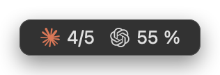
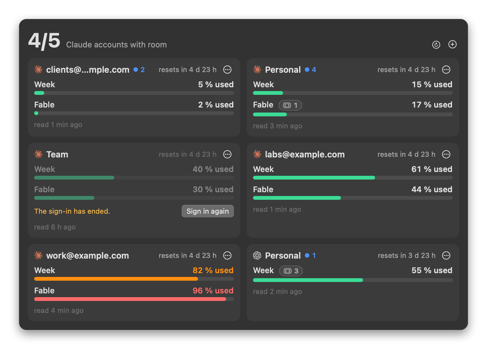
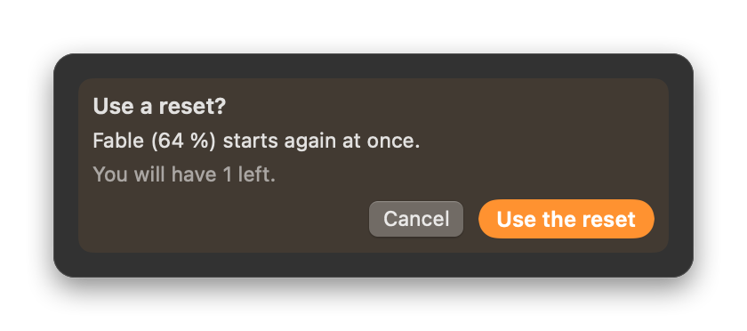

# The accounts window

[← Back to the README](../README.md)

The accounts item shows how much of your Claude and Codex subscriptions you have used, for every
account you follow, so you know which one to work on next. Its window lists each account's
limits, the sessions running on it, and the free resets it can spend.

- [Following an account](#following-an-account)
- [The menu bar item](#the-menu-bar-item)
- [Reading the window](#reading-the-window)
- [Accounts in use](#accounts-in-use)
- [Free resets](#free-resets)
- [Renaming, signing in again, removing](#renaming-signing-in-again-removing)
- [Limits](#limits)

## Following an account

At the bottom of the agents window, **Claude and Codex quotas** opens a button per provider.
**Connect** opens the provider's page in your browser. You allow DevMonitor there, then the
window shows the account's email with an empty **Name** field: type a name, or leave it empty to
call the account by its email. **Add** follows it.

To follow another account of the same provider, switch accounts in your browser first, then
click **+** in the accounts window.

- **Claude**: DevMonitor asks to read your profile only. That access cannot run a model or create
  an API key.
- **Codex**: OpenAI offers only the access the Codex client gets, which could also run Codex.
  DevMonitor uses it to read your usage, and to spend a reset when you confirm one.

Each sign-in uses the provider's own agent's public client id, the only one either provider
offers. It is kept in your login keychain: see [Privacy](safety-and-privacy.md#privacy).

## The menu bar item

The item appears once you follow an account. It shows:

- the Claude logo and how many of your Claude accounts have room, out of how many you follow. An
  account has room while every one of its limits is under 95 %. The count turns orange when one
  account has room left, and red when none has;
- the Codex logo and the share used of Codex's fullest limit, orange from 80 % and red from 95 %.

## Reading the window

The top of the window repeats the Claude count. Each account has a block, in two columns from
three accounts on: Claude's accounts first, the one with the most room first, then Codex's.

- **One gauge per limit**, filled with the share already used: the week, and the week on one
  model (Fable). Codex's limits are named by their length. A gauge turns a strong orange from
  80 % and red by 95 %.
- **When the limits start again**, once per account when they all start again at the same time,
  as a countdown.
- **When it was read**. A block the last read could not renew stays greyed with its age.

Every account is read every ten minutes, day and night, and again when the window opens if its
last read is more than two minutes old. **↻** reads every account now. When a provider asks to
wait, DevMonitor waits as long as it says.

## Accounts in use

A blue dot and a number beside an account's name mean that many agent sessions on your Mac draw
on it. Hovering it says "in use · 4 sessions".

DevMonitor reads, for each Claude Code or Codex session it lists, the environment the session
started with (`HOME`, `CLAUDE_CONFIG_DIR`, `CODEX_HOME`), then the account its config folder is
signed in with: the two ids of `oauthAccount` in `.claude.json`, or the account id in Codex's
`auth.json`. A session sent elsewhere gets no dot: through a proxy (`ANTHROPIC_BASE_URL`,
`OPENAI_BASE_URL`), an API key, a token of its own, Bedrock or Vertex, or another Codex provider.

## Free resets

Claude and OpenAI sometimes grant an account free resets, which start some of its limits again at
once. A ticket with a number shows beside the limit they start again. A Codex reset starts every
limit of the account again.

A click on the ticket opens a confirmation inside the account's block. It says what starts again
with its share now, how many resets will be left, when the reset expires, and warns when almost
nothing is used. **Use the reset** sends one request. A refusal shows the provider's status and
its words; with no answer, DevMonitor reads the account again to learn whether the reset was used,
and never sends the request again by itself.

Claude lists an account's resets only to Claude Code. So the reads made when the window opens, on
**↻** and after a reset call themselves Claude Code, as does the request that spends a reset. The
reads every ten minutes do not.

 

## Renaming, signing in again, removing

The `…` menu of each block renames the account, signs in again, or removes it. Removing an
account deletes its sign-in from your keychain.

A Claude sign-in lasts about four weeks and is not extended by its renewals. **Sign in again**
shows on the block three days before it ends, and once it has ended.

## Limits

- The addresses DevMonitor reads are the ones the providers' own agents use. They are not public
  APIs: a provider can change them or stop answering at any time.
- Spending a Claude reset with the read-only access DevMonitor asks for has not been tried yet.
  Claude may refuse it; the window then shows the provider's answer.
- Codex may answer that nothing needs a reset, and keep it.
- A session is matched to an account by the config folder it started with: every session of a
  folder counts on the account that folder is signed in to now, even one started under another.
- DevMonitor does not know a limit before the provider reports it, nor what a reset will give
  back beyond the limits the provider names.
