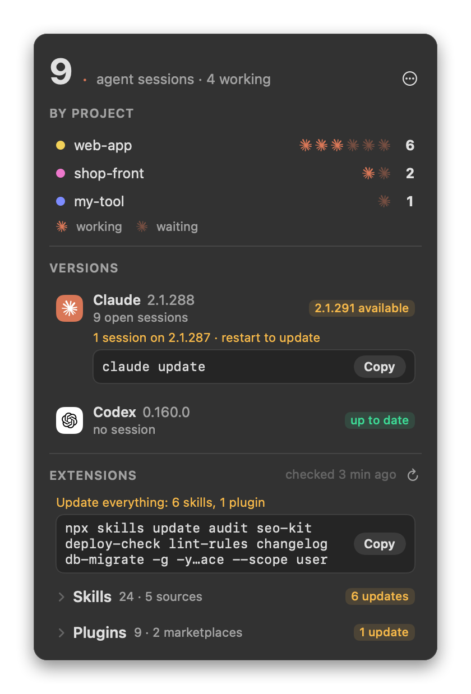
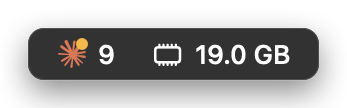

# The agents window

[← Back to the README](../README.md)

The agents item in the menu bar counts the coding agent sessions running on your Mac. Its window
says where they run, which ones are working, and which agent has an update you have not run.

- [The menu bar item](#the-menu-bar-item)
- [Sessions by project](#sessions-by-project)
- [Versions](#versions)
- [Settings](#settings)
- [Limits](#limits)

## The menu bar item

The item shows the logo of each agent that has a session, side by side, then the total number of
sessions. When no agent has a session, it shows the first agent installed, so the window stays
one click away.

- A logo turns while its agent works.
- An orange dot on a logo means a new version of that agent is published.

DevMonitor knows Claude Code, Codex, Gemini CLI, Cursor Agent, opencode, Aider and Amp.

## Sessions by project

The top of the window gives the number of sessions and how many are working. **By project**
lists the projects that have a session, with one mark per session: bright while the session
works, dim while it waits for you.

A Codex that another agent started (Claude running `codex exec` for a review) counts as a
session too. The versions section says so on the agent's line: "1 launched by Claude".

Agent sessions are counted and never stopped: see [Safety](safety-and-privacy.md#safety).

## Versions

Each installed agent has a line with its version, its number of open sessions and its state:

| State | Meaning |
| --- | --- |
| `up to date` | The installed version is the latest published. |
| `2.1.291 available` | A newer version is published. The line shows the command that installs it, with a **Copy** button. |
| `latest version unknown` | The latest version could not be read, or the check is off. |
| `version unreadable` | The agent is installed and its version could not be read. |

An update does not reach the sessions already running. When some still run an older version,
the line says how many and from which version: "1 session on 2.1.287 · restart to update".

The installed versions are read again when the window opens and as soon as an update replaces
an agent's command. The latest versions are asked every 6 hours: see
[Privacy](safety-and-privacy.md#privacy) for where.

Below the versions, the window lists your [skills and plugins](extensions.md).

## Settings

The `…` menu of the window has two switches:

- **Check for new versions**: turns off every network request of the app, for the agents and for
  the skills.
- **Animate the logo while an agent works**: each turn of the logo makes macOS redraw the menu
  bar item, about once a second. Turn it off for a still logo.

## Limits

- DevMonitor does not know where Cursor Agent publishes its versions, so its status shows as
  unknown.
- "Working" is read from the CPU a session used between two scans: it streams, renders or runs
  a tool. DevMonitor does not read what the session is doing.
