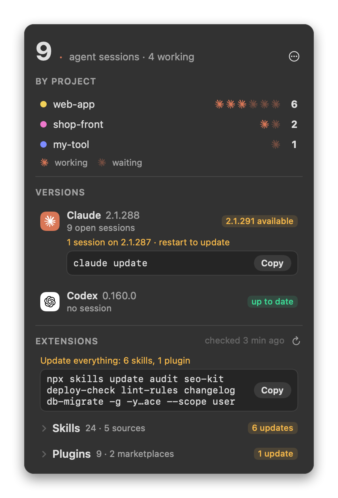

# Skills and plugins

[← Back to the README](../README.md)

Under the agents' versions, the [agents window](agents-window.md) lists the extensions installed
on your Mac and says which ones have an update. The section is hidden when you have none.

- [What is listed](#what-is-listed)
- [Updating](#updating)
- [The states of a source](#the-states-of-a-source)
- [When updates are looked for](#when-updates-are-looked-for)
- [Limits](#limits)

## What is listed

- **Skills**: the global skills installed with `npx skills`, grouped by the repository they come
  from.
- **Plugins**: the Claude Code plugins installed with `claude plugin`, grouped by marketplace.

Each kind is one line with its count, its number of sources and its number of updates. Click the
line to list its sources; click a source to see what to do about it. One source is expanded at
a time, so the window stays short.

The header says when GitHub last answered about the skills, and its ↻ button asks again now.

## Updating

DevMonitor never updates anything itself. It gives you the command and a **Copy** button:

- **Update everything** is one command for every skill and plugin that has an update, for
  example `npx skills update audit seo-kit -g -y; claude plugin update lint@acme --scope user`.
  A long command keeps three lines and is cut in the middle; **Copy** always copies all of it.
- An expanded repository gives the command that updates its skills alone; an expanded
  marketplace gives one command per plugin.

The list follows the update as soon as the command that made it is done: the skills lock file
and Claude Code's plugin files are watched.

## The states of a source

| Mark | Meaning |
| --- | --- |
| `6 updates` | That many skills or plugins of the source have an update. |
| `2 moved` | Skills whose folder no longer exists at that place in its repository: renamed, merged or removed. |
| `unknown` | The state could not be read. Expand the source for the reason: the lock file keeps nothing to compare, the source is not a GitHub repository, GitHub did not give the repository's tree, or the marketplace's catalog is not on this Mac. |

Sources with nothing to report are summed up on one line under the others.

## When updates are looked for

**Skills** are compared the way `skills update` does it: the git tree hash of each skill's folder
against the one in its repository on GitHub. DevMonitor asks GitHub's git server which commit
each repository is at, then GitHub's API for the file tree of the repositories whose commit
moved. It asks:

- every 15 minutes;
- when the agents window opens, if the last check started more than 5 minutes ago;
- when you press ↻.

**Plugins** are compared with the marketplaces already on your Mac, with no request: by commit,
by declared version, or file by file when a plugin has neither.

When **Check for new versions** is off in the `…` menu of the window, GitHub is not asked and
the skills read as not checked.
[Privacy](safety-and-privacy.md#privacy) says what each request carries.

## Limits

- Only global skills are listed (`~/.agents/.skill-lock.json`), not the ones a project installs,
  nor skills copied by hand into `~/.claude/skills`.
- GitHub's API allows 60 anonymous requests per hour for your whole network address, shared with
  `npx skills update`, and an unchanged answer counts too. DevMonitor asks it only when a
  repository's commit moved, once per repository at launch, and at most every 6 hours for a
  repository the git server gives no commit for. When it refuses, the last answer is kept, and a
  skill updated since that answer reads as up to date until GitHub answers again.
- Private repositories always read as unknown.
- A plugin's state is as fresh as its marketplace on your Mac: DevMonitor never refreshes one.
  Past seven days it shows the command that does, `claude plugin marketplace update`.
- A plugin pinned to a commit of another repository shows an update as soon as its marketplace
  pins a newer commit, unless the catalog gives its version. If the plugin's version did not
  change, `claude plugin update` answers that it is already the latest.
- When a name has special characters, the update is shown and no command is offered.
