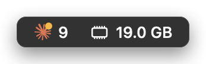

# Install, update, uninstall

[← Back to the README](../README.md)

- [Requirements](#requirements)
- [Install](#install)
- [Launch at login](#launch-at-login)
- [Update](#update)
- [Uninstall](#uninstall)
- [Common problems](#common-problems)

## Requirements

- macOS 14 or later.
- Apple's command line developer tools (`xcode-select --install`): the app is built on your Mac.
- Optional: Docker (Desktop, OrbStack, Colima or Rancher Desktop) for the container rows.
- Optional: one or more coding agents — Claude Code, Codex, Gemini CLI, Cursor Agent, opencode,
  Aider, Amp — for the agents item.

## Install

Paste this in Terminal, without `sudo`:

```bash
curl -fsSL https://raw.githubusercontent.com/samuelbelolo/devmonitor/main/scripts/install.sh | bash
```

It downloads the source, builds the app (about a minute), copies it to `/Applications` (or
`~/Applications`) and launches it. Two items appear in the menu bar: the memory your projects
hold, and your agent sessions.



The app is built locally because it is not notarized by Apple: a downloaded copy would be
blocked by Gatekeeper.

From a clone of the repository, `make install` does the same.

## Launch at login

Open the `…` menu of the memory window and tick **Launch at login**. macOS lists the app under
**System Settings → General → Login Items**.

## Update

Run the install command again:

```bash
curl -fsSL https://raw.githubusercontent.com/samuelbelolo/devmonitor/main/scripts/install.sh | bash
```

It builds the latest version, quits the running app, replaces it and starts the new one. Your
settings stay. From a clone: `git pull`, then `make install`.

The app does not tell you when a new version of itself is out. To be notified, watch the
repository's releases on GitHub (**Watch → Custom → Releases**).

## Uninstall

Untick **Launch at login**, choose **Quit** in the `…` menu, and delete the app.

If you follow Claude or Codex accounts, remove each one from the `…` menu of its block first:
that deletes its sign-in from your keychain. Once the app is deleted, the items left behind show
in Keychain Access under the names `local.devmonitor.claude` and `local.devmonitor.codex`. The
access you gave DevMonitor on each account ends by itself, after about four weeks for Claude.

## Common problems

**The install stops and asks for developer tools.** Run `xcode-select --install`, wait for it
to finish, then run the install command again.

**Launch at login no longer starts the app after an update.** Untick **Launch at login** and
tick it again: each build is signed anew on your Mac.

**The container rows are missing.** They need a running Docker (Desktop, OrbStack, Colima or
Rancher Desktop). DevMonitor reads it through the Docker command, against the local socket only.

**The agents item shows no version status for Cursor Agent.** DevMonitor does not know where
Cursor Agent publishes its versions, so its status shows as unknown.
