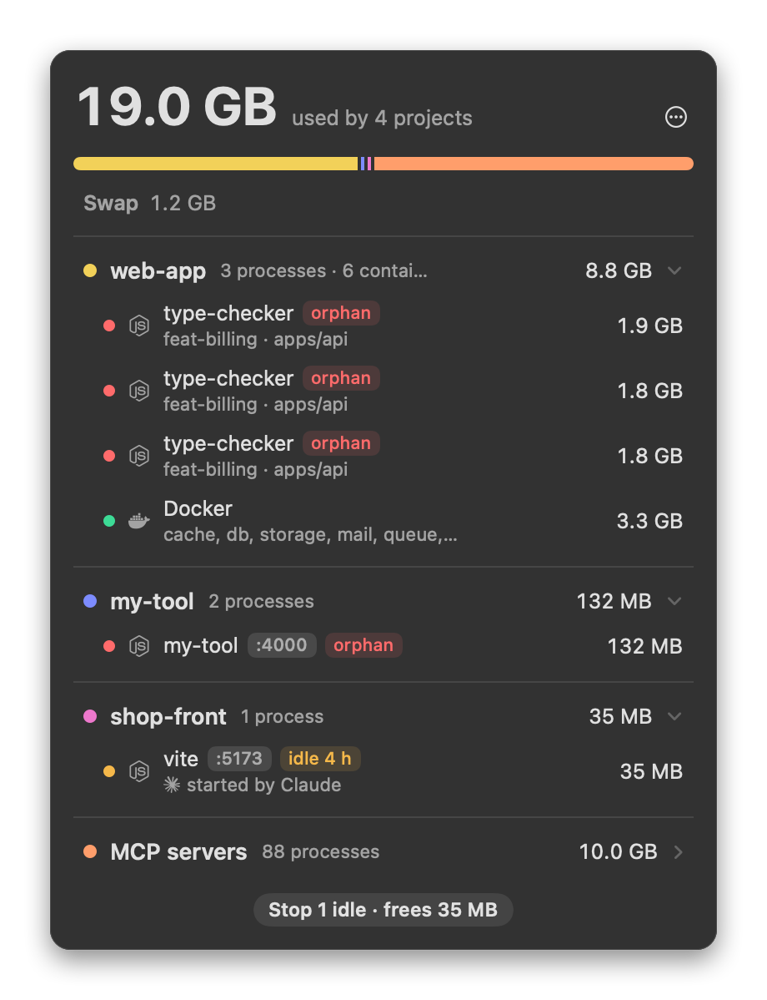
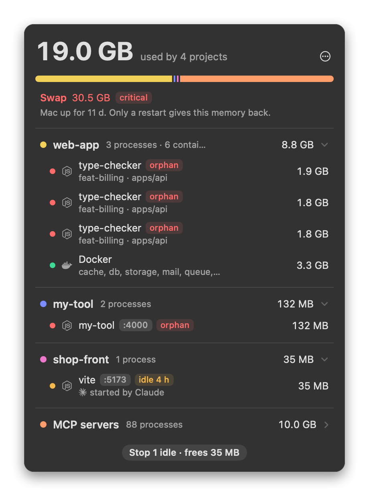

# The memory window

[← Back to the README](../README.md)

The memory item in the menu bar shows the memory your projects hold, for example `19.0 GB`.
Click it to see where that memory goes and to stop what you forgot.

- [Reading the list](#reading-the-list)
- [Stopping a service or a project](#stopping-a-service-or-a-project)
- [The Swap line](#the-swap-line)
- [Limits](#limits)

## Reading the list

The window opens on the total and a bar that shares it between the projects, one colour each.
Below, there is one group per git repository. The worktrees of a repository and its Docker
Compose containers are in the same group as its main checkout.

Each line of a group is a service: a dev server, a worker, a type checker. It shows:

- the service's name, with the worktree and the package it runs in on the line below;
- the ports it listens on, such as `:5173`;
- the memory it holds, children included;
- who started it when a coding agent did, such as "started by Claude".

Two tags point at what you probably forgot:

- `orphan`: the process that started it died, and it kept running.
- `idle 4 h`: it has used no CPU for 10 minutes or more; the tag says for how long.

The containers of a Compose project share one **Docker** line with their names.

**MCP servers** and the other tools of your agent sessions have their own group at the end,
collapsed, whatever project they were started in. Click a group's header to open or close it.

The list is read again every 3 seconds while the window is open, and every 30 seconds otherwise.

 

## Stopping a service or a project

Every stop takes two clicks. The first one turns the button red and makes it read **Confirm**
for three seconds; the second one confirms. Without a second click, nothing is stopped.

| To stop | Do this |
| --- | --- |
| One service and everything it started | Hover its line, click the cross, then **Confirm** |
| A whole project: its services and its containers | Hover its header, click **Stop**, then **Confirm** |
| Every idle service at once | Click **Stop N idle**, then confirm |

**Stop N idle** stops the idle services counted at the first click: a service that became idle
between your two clicks is left alone. MCP servers are never part of it, because stopping one
breaks the agent session that uses it.

A process still running 5 seconds after a stop gets a **Force quit** button.

What DevMonitor never stops is listed in [Safety and privacy](safety-and-privacy.md#safety).

## The Swap line

A Mac can crawl while macOS reports plenty of free memory: what it lacks sits in the swap, and
only a restart gives a large swap back. Under the total, the **Swap** line is always shown.

| Swap in use | Line | Menu bar chip |
| --- | --- | --- |
| Up to a quarter of the Mac's memory | Grey |  |
| Above a quarter | Orange |  |
| Above half | Red, tagged `critical` |  |

A red line adds how long the Mac has been up and that only a restart gives this memory back:

The swap is measured against the memory installed in the Mac. macOS grows the swap as it
fills, so the share of the swap in use says nothing.

## Limits

- **Idle means "no CPU"**, not "unused": read the tagged lines before **Stop N idle**.
- A program waiting in a terminal that is not on the protected list (a REPL, `psql`) is listed
  like a server.
- An MCP server whose agent died is recognised by its command name only.
- The swap thresholds are fixed, a quarter and half of the installed memory: a Mac that lives
  above a quarter keeps an orange chip.
- It is not a security tool: a program can keep out of the list by naming itself like a
  protected one.
